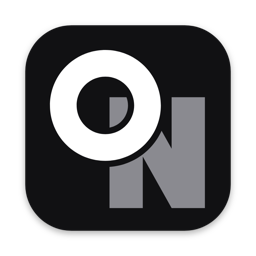
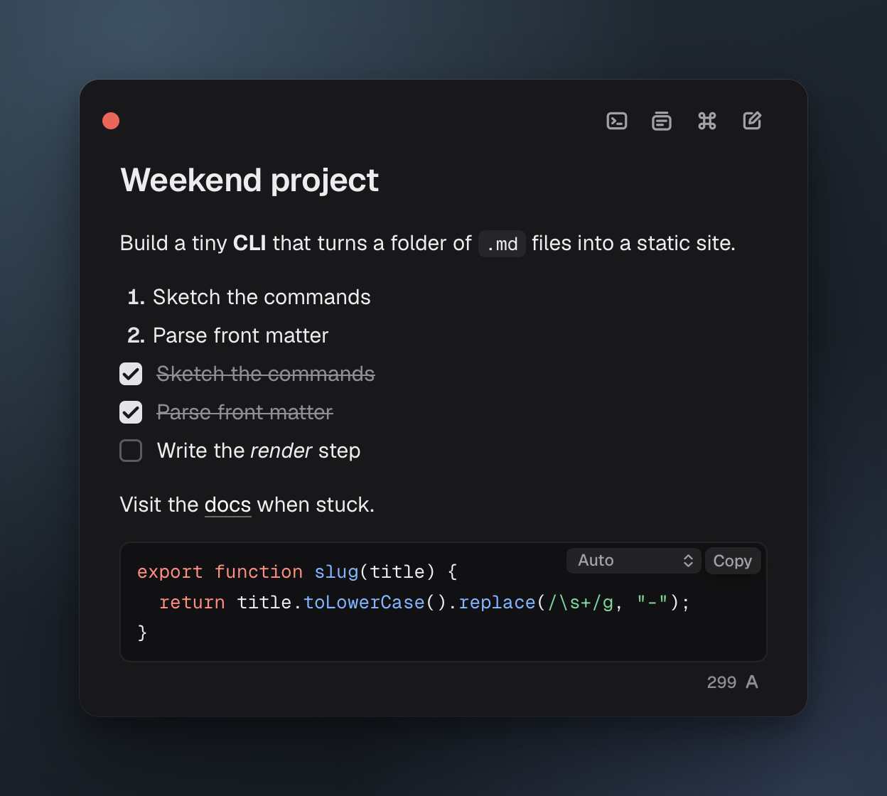
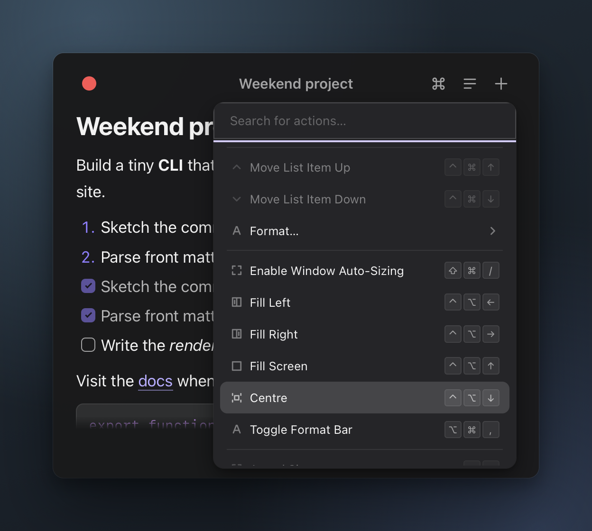
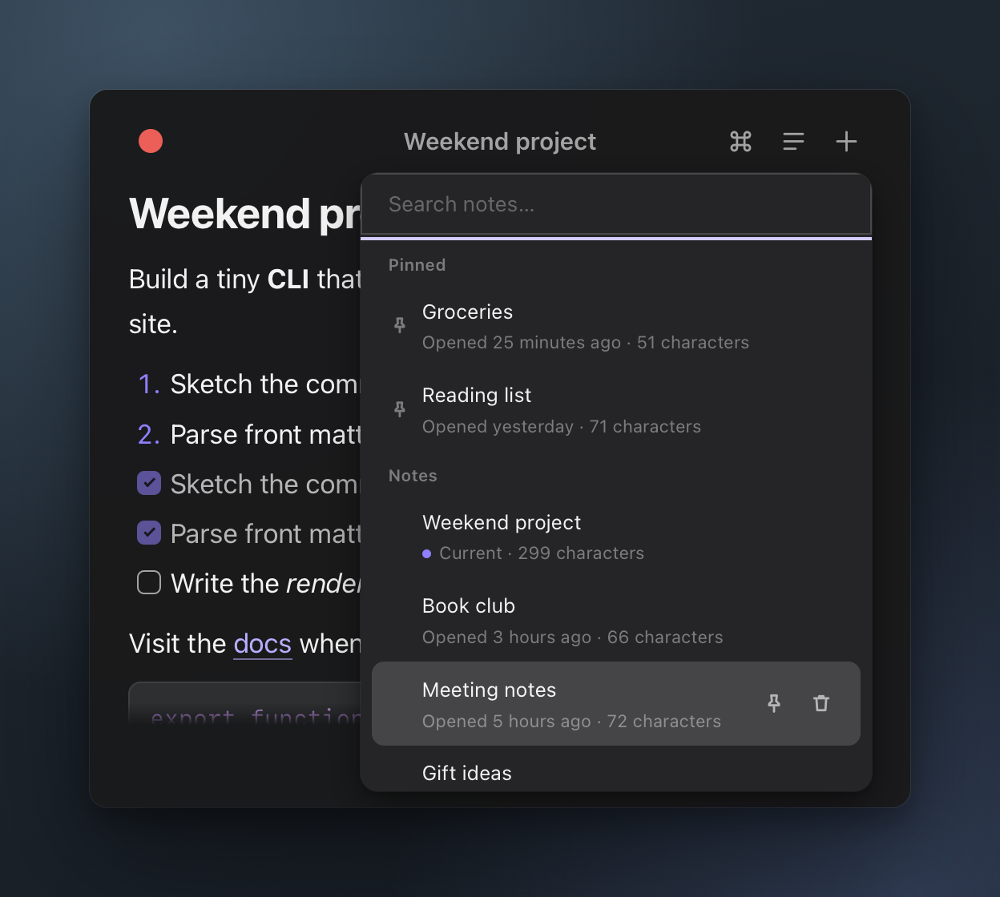

<p align="center">
  
</p>

<h1 align="center">Overnote</h1>

[](LICENSE)
[](https://github.com/WesleyBLDC/overnote/releases)
[](https://github.com/WesleyBLDC/overnote/actions/workflows/ci.yml) <!-- store:remove-line -->

A floating Markdown notepad for Raycast.
One hotkey opens a panel over whatever you are doing, without stealing focus from the app underneath.
Press it again and it is gone.

<p align="center">
  <picture>
    <source media="(prefers-color-scheme: light)" srcset="media/note-light.png" />
    
  </picture>
</p>

## Why Overnote

- **Open source.** MIT licensed; everything lives in this repository.
- **Scriptable.** Deeplinks for quicklinks and scripts, plus a documented socket protocol ([docs/architecture.md](docs/architecture.md)).
- **Local data.** One SQLite file on your Mac, with automatic daily backups.
- **Updates you control.** Check for Updates, then one command that backs up and installs. <!-- store:remove-line -->

## Features

- Floating panel over full-screen apps and every Space; typing without stealing focus
- Markdown as you type, `/` slash menu, emoji picker, format bar
- Tasks (⌘↩), nested lists, syntax-highlighted code, find and replace (⌘F)
- Pins (⇧⌘P, ⌘1–⌘9), browse (⌘P), history (⌘[ / ⌘])
- Window placement: Fill Left / Right / Screen / Centre (⌃⌥ arrows, ⌘K, or the menu bar)
- Export and copy as Markdown, HTML, or plain text; Recently Deleted for 60 days
- Raycast commands: Search Notes, Create Note, Open Overnote, Recently Deleted, optional menu bar
- Deeplinks and quicklinks to open a specific note

<p align="center">
  
  
</p>

<!-- store:remove -->
## Install

Overnote is a Raycast extension (not in the Store yet), and can also be built as a local menu bar app, `Overnote.app`; both are named Overnote and share the same notes.
Needs an Apple silicon Mac, macOS 14+, [Raycast](https://www.raycast.com) signed in, and [Node.js](https://nodejs.org) 22+.

1. Download `overnote-<version>.zip` from the latest [release](https://github.com/WesleyBLDC/overnote/releases), unzip, and move the folder to e.g. `~/Applications/Overnote`.
2. `cd ~/Applications/Overnote && npm run install-extension`
3. In Raycast Settings → Extensions, bind a hotkey to **Toggle Overnote**.

Update with `npm run update-extension` in the same folder.

**Local app (no Raycast needed to run it).**
From a source checkout, `npm run app:install` builds `Overnote.app`, signed for your Mac only, and copies it to `/Applications`.
It lives in the menu bar and toggles the panel with ⌃⌥N; while it runs, the extension's commands use its panel.

Full guide: [`docs/install.md`](docs/install.md).
From source: [`CONTRIBUTING.md`](CONTRIBUTING.md).
<!-- /store:remove -->

## Usage

Press your hotkey to show or hide the panel.
Everything saves automatically.
⌘K lists every action and shortcut.

<details>
<summary>Panel shortcuts</summary>

| Shortcut | Action |
|---|---|
| ⌘K | Action panel |
| ⌘P | Browse notes |
| ⌘N / ⌘D | New / duplicate |
| ⇧⌘P | Pin or unpin |
| ⌘1–⌘9 | Open pinned 1–9 |
| ⌘[ / ⌘] | Back / forward |
| ⌘F | Find (⌥⌘↓ for replace) |
| ⇧⌘C / ⇧⌘E | Copy / export |
| ⇧⌘D / ⇧⌘L | Deeplink / Quicklink |
| ⌘, | Settings |
| ⌃⌥← → ↑ ↓ | Fill left / right / screen / centre |
| ⌘= / ⌘- / ⌘0 | Zoom |
| ⎋ or ⌘W | Hide |

</details>

<details>
<summary>Formatting shortcuts</summary>

| Shortcut | Action |
|---|---|
| ⌘B / ⌘I / ⌘U / ⇧⌘S | Bold / italic / underline / strike |
| ⌘E / ⌘L | Inline code / link |
| ⌥⌘1–3 / ⌥⌘C / ⇧⌘B | Heading / code block / quote |
| ⇧⌘7 / 8 / 9 | Numbered / bullet / task list |
| ⌘↩ | Check task; open link; leave code block |
| Tab / ⇧Tab | Indent / outdent |
| `/` / `:` | Slash menu / emoji |

</details>

<details>
<summary>Raycast commands</summary>

| Command | What it does |
|---|---|
| Toggle Overnote | Show or hide the panel (bind your hotkey here) |
| Open Overnote | Show on the last note; never hides |
| Create Note | From argument, search text, or selection |
| Search Notes | List, preview, pin, backup, restore |
| Recently Deleted Notes | Restore or purge |
| Overnote Menu Bar | Pins, recent notes, placements, backups (off by default) |
| Check for Updates | Copy the update command when a newer release exists <!-- store:remove-line --> |

</details>

Writing tips: [`docs/writing-notes.md`](docs/writing-notes.md).

## Your data

Notes live in `~/Library/Application Support/Overnote`, with backups in its `backups` folder.
No account, no analytics; the panel cannot make network connections.
Check for Updates is the only network call (GitHub releases). <!-- store:remove-line -->
Backup and restore actions are in Search Notes and the menu bar; see [`docs/install.md`](docs/install.md).

<!-- store:remove -->
## Agents and development

For AI coding agents, use [overnote-axi](https://github.com/WesleyBLDC/overnote-axi) (`overnote-axi setup` / `overnote-axi setup skill`).

```sh
npm install
npm run dev              # extension in Raycast
npm run dev -w editor    # editor harness (port 5199)
npm run verify           # full local gate
```

| Doc | Contents |
|---|---|
| [`CONTRIBUTING.md`](CONTRIBUTING.md) | Setup, layout, testing, clean room |
| [`SUPPORT.md`](SUPPORT.md) | Where to get help |
| [`SECURITY.md`](SECURITY.md) | Report a vulnerability privately |
| [`CODE_OF_CONDUCT.md`](CODE_OF_CONDUCT.md) | How we treat each other |
| [`docs/architecture.md`](docs/architecture.md) | Protocol and parts |
| [`docs/install.md`](docs/install.md) | Install, update, backups |
| [`docs/releasing.md`](docs/releasing.md) | Release packaging |
| [`docs/clean-room.md`](docs/clean-room.md) | Clean-room process |
| [`CHANGELOG.md`](CHANGELOG.md) | Store changelog |
| [Releases](https://github.com/WesleyBLDC/overnote/releases) | Zips and source summaries |

**Roadmap:** multi-note, tags or folders, ranked search, backlinks, images, templates; Store submission; optional Markdown mirror folder.
<!-- /store:remove -->

## License

[MIT](LICENSE) © 2026 WesleyBLDC.

Clean-room reimplementation of Raycast Notes behaviour ([`docs/clean-room.md`](docs/clean-room.md)).
Not affiliated with or endorsed by Raycast.
