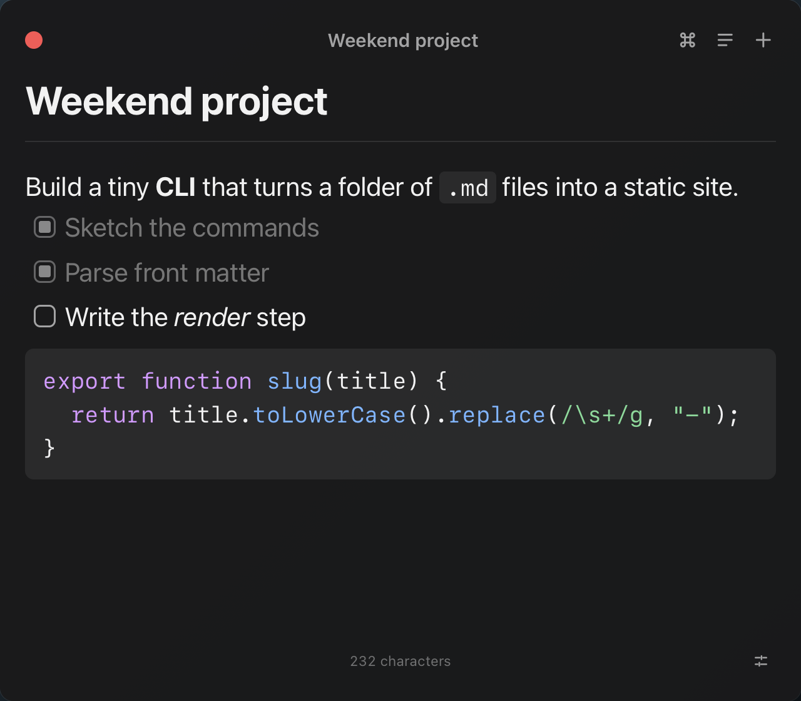
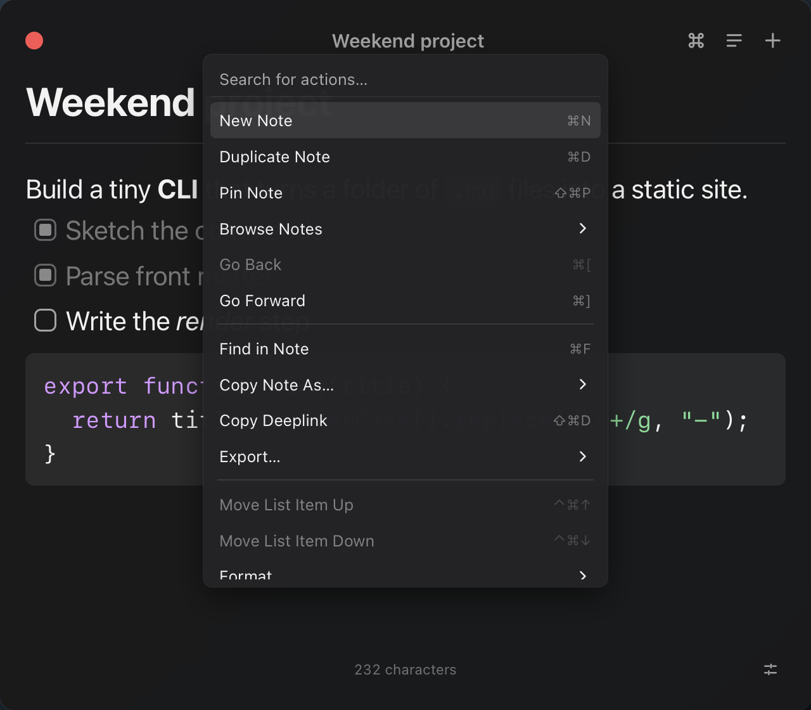
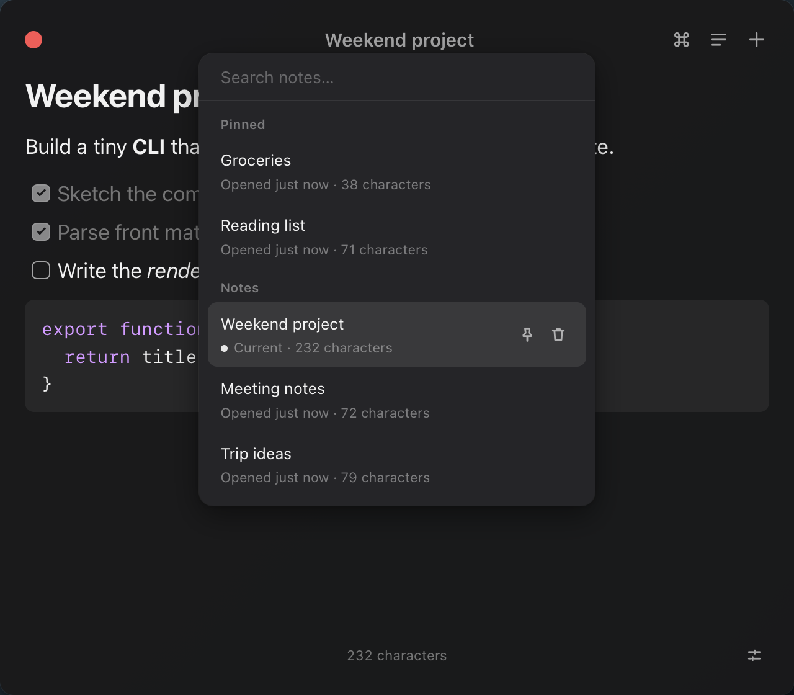

# Overnote

A floating Markdown notepad for Raycast, one hotkey away.
Press your hotkey and a small notes panel floats over whatever you are doing, ready for typing, without pulling focus away from the app underneath.
Press it again and it is gone.

<p align="center">
  <picture>
    <source media="(prefers-color-scheme: light)" srcset="media/note-light.png" />
    
  </picture>
</p>

## Why Overnote

Overnote works like the notes you already know from Raycast, and adds what a built-in tool cannot:

- **Open source.** MIT licensed, with every part of it in this repository.
- **Extensible.** Every note has a deeplink for quicklinks and scripts, and the code is built to take add-ons, such as a Markdown mirror folder.
- **Your data, on your Mac.** Notes live in one local SQLite file, with automatic daily backups you can restore from Raycast.
- **Updates you control.** Check for Updates tells you when a new release is out, and one command installs it after backing up your notes. <!-- store:remove-line -->

Overnote is inspired by Raycast Notes and is not affiliated with Raycast.

## Features

- **A floating panel that never steals focus.**
  It opens over full-screen apps and on every Space, takes your keystrokes, and leaves the app you were in active.
- **Markdown as you type.**
  Shortcuts like `#`, `-`, `1.`, `[ ]`, `>`, and fenced code turn into formatting on the spot, and a `/` slash menu inserts any block.
- **Task lists** with ⌘↩ to check and uncheck, including nested tasks.
- **Code blocks** with syntax highlighting.
- **Find and replace** inside a note with ⌘F.
- **Pins:** pin notes with ⇧⌘P and jump to the first nine with ⌘1 to ⌘9.
- **History:** go back and forward through the notes you opened with ⌘[ and ⌘].
- **Browse** every note with ⌘P, searching titles and text.
- **Recently Deleted:** deleted notes stay restorable for 60 days.
- **Export and copy** a note, or just the selection, as Markdown, HTML, or plain text.
- **Backups:** one a day, and one before every restore and database upgrade, kept outside the extension.
- **Raycast commands:** Search Notes with a rendered preview, Create Note from an argument, the search bar, or the selected text, and Recently Deleted Notes.
- **Menu bar** with pinned and recent notes, one click away.
- **Deeplinks and quicklinks** that open a specific note from anywhere.

<p align="center">
  
  
</p>

<!-- store:remove -->
## Install

Overnote is not in the Raycast Store yet.
You need macOS 14 Sonoma or later, [Raycast](https://www.raycast.com) installed and signed in, and [Node.js](https://nodejs.org) 22 or later.

1. Download `overnote-<version>.zip` from the latest [release](https://github.com/WesleyBLDC/overnote/releases) and unzip it.
2. Double-click **Install Overnote.command** in the `overnote` folder.
   It moves the folder to `~/Applications/Overnote` and installs the extension into Raycast.
3. Open Raycast Settings, go to Extensions, find **Toggle Overnote**, and record a hotkey for it, for example ⌥N.

To update, run **Check for Updates** in Raycast; the update backs up your notes first.
[`docs/install.md`](docs/install.md) covers updating, backups, uninstalling, and troubleshooting.

To build from source instead, you also need the Xcode Command Line Tools (`xcode-select --install`):

```sh
git clone https://github.com/WesleyBLDC/overnote.git
cd overnote
npm install
npm run dev
```

Once Raycast lists the Overnote commands, stop `npm run dev` with ⌃C; the extension stays installed.
<!-- /store:remove -->

## Usage

Bind a hotkey to **Toggle Overnote** in Raycast Settings, then press it to show the panel, type, and press it again (or ⎋) to hide it.
Everything saves automatically.
Press ⌘K in the panel to see every action with its shortcut.

### Panel shortcuts

| Shortcut | Action |
|---|---|
| ⌘K | Open or close the action panel |
| ⌘P | Browse notes |
| ⌘N | New note |
| ⌘D | Duplicate note |
| ⇧⌘P | Pin or unpin the note |
| ⌘1 to ⌘9 | Open pinned note 1 to 9 |
| ⌘[ / ⌘] | Go back / go forward (also ⌥⌘↓ / ⌥⌘↑) |
| ⌘F | Find; ⌥⌘↓ in the find field shows replace |
| ⇧⌘C | Copy note (or selection) as Markdown, HTML, or text |
| ⇧⌘E | Export as Markdown, HTML, or text |
| ⇧⌘D | Copy deeplink |
| ⌃X | Delete note (restorable for 60 days) |
| ⌃⇧X | Delete all notes, after a confirmation |
| ⌥⌘, | Show or hide the format bar |
| ⇧⌘, | Format menu |
| ⌃⌘↑ / ⌃⌘↓ | Move list item up / down |
| ⇧⌘/ | Toggle window auto-sizing |
| ⌘= / ⌘- / ⌘0 | Zoom in / zoom out / actual size (75% to 200%) |
| ⎋ or ⌘W | Hide the panel |

### Formatting shortcuts

| Shortcut | Action |
|---|---|
| ⌘B / ⌘I / ⌘U | Bold / italic / underline |
| ⇧⌘S | Strikethrough |
| ⌘E | Inline code |
| ⌘L | Add or edit a link |
| ⌥⌘1 / ⌥⌘2 / ⌥⌘3 | Heading 1 / 2 / 3 |
| ⌥⌘C | Code block |
| ⇧⌘B | Blockquote |
| ⇧⌘7 / ⇧⌘8 / ⇧⌘9 | Numbered / bulleted / task list |
| ⌘↩ | Check or uncheck a task; open a link; leave a code block |
| ⇧⌘↩ | Toggle a task together with its nested tasks |
| Tab / ⇧Tab | Indent / outdent a list item |
| ⇧⌘V | Paste as plain text |
| `/` | Slash menu |
| `:` | Emoji picker |

### Raycast commands

| Command | What it does |
|---|---|
| Toggle Overnote | Shows or hides the floating panel. Bind your hotkey here. |
| Create Note | Creates a note from its argument, the Raycast search text, or the selected text, and opens it. |
| Search Notes | Lists notes by date with a preview, and opens, pins, copies, duplicates, deletes, backs up, and restores them. |
| Recently Deleted Notes | Restores deleted notes or removes them for good. |
| Overnote Menu Bar | Pinned and recent notes in the menu bar, plus the backup actions. Off by default; enable it in Raycast Settings. |
| Check for Updates | Compares your version with the latest release and, when a newer one exists, copies the update command. <!-- store:remove-line --> |

Copy Deeplink (⇧⌘D in the panel, or in Search Notes) gives you a `raycast://` link that opens that exact note.
Create Quicklink in Search Notes saves it as a Raycast quicklink.

## Your data

- Notes live in one SQLite file in the extension's Raycast support folder, and never leave your Mac.
- Backups go to `~/Library/Application Support/Overnote/backups`, outside the extension, so they survive removing it.
  Overnote writes one a day, and one before every restore and database upgrade, and keeps the latest 10 plus one per week for the last 4 weeks.
  `npm run update-extension` also writes one before it updates. <!-- store:remove-line -->
- **Back Up Notes Now**, **Restore Notes from Backup**, and **Reveal Backups Folder** are in Search Notes and the menu bar.
  A restore backs up the current notes first, so it can be undone.
- After a reinstall, Search Notes offers to restore your latest backup.
- Deleted notes are purged after 60 days.
- Overnote has no account and no analytics, and the notes panel cannot make network connections.
- The only network request is Check for Updates, which asks GitHub for the latest release when you run it. <!-- store:remove-line -->

<!-- store:remove -->
## Development

See [CONTRIBUTING.md](CONTRIBUTING.md) for the setup, the project layout, the test suites, and the clean-room rule.
In short: `npm install`, then `npm run dev` to run the extension in Raycast, `npm run dev -w editor` to work on the editor in a browser, and `npm run verify` to run every check in the same order as CI.

| Doc | Contents |
|---|---|
| [`docs/architecture.md`](docs/architecture.md) | How the parts fit together, and the protocol reference |
| [`docs/install.md`](docs/install.md) | Installing from a release, updating, backups, and uninstalling |
| [`docs/releasing.md`](docs/releasing.md) | How releases are built and published |
| [`docs/clean-room.md`](docs/clean-room.md) | The clean-room process |
| [`CHANGELOG.md`](CHANGELOG.md) | Release notes |

## Roadmap

Overnote covers what Raycast Notes does, minus AI and sync, and ships as GitHub releases.
Next:

- Our own features: unlimited notes, several notes open at once, tags or folders, ranked search, backlinks, image paste, and templates.
- A Raycast Store submission.
- Add-ons, such as a one-way Markdown mirror folder.
<!-- /store:remove -->

## Source and builds

Overnote ships a small native macOS app that draws the floating panel and keeps the notes database.
Its Swift sources are in [`helper/`](https://github.com/WesleyBLDC/overnote/tree/main/helper), and `scripts/build-helper.sh` builds the universal binary with only the Xcode Command Line Tools.
The extension checks that binary against its `assets/bin/OvernoteHelper.sha256` before every start.

## License

[MIT](LICENSE) © 2026 WesleyBLDC.

Overnote follows the behavior and layout of Raycast Notes, built clean-room from written behavior specs (see [`docs/clean-room.md`](docs/clean-room.md)).
It is not affiliated with or endorsed by Raycast, and it uses its own name, icon, colors, and design.
