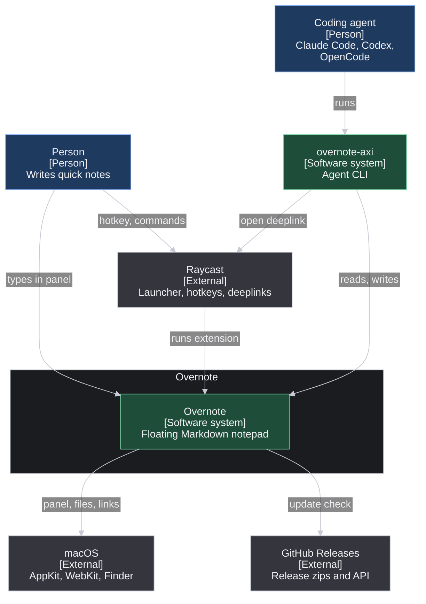
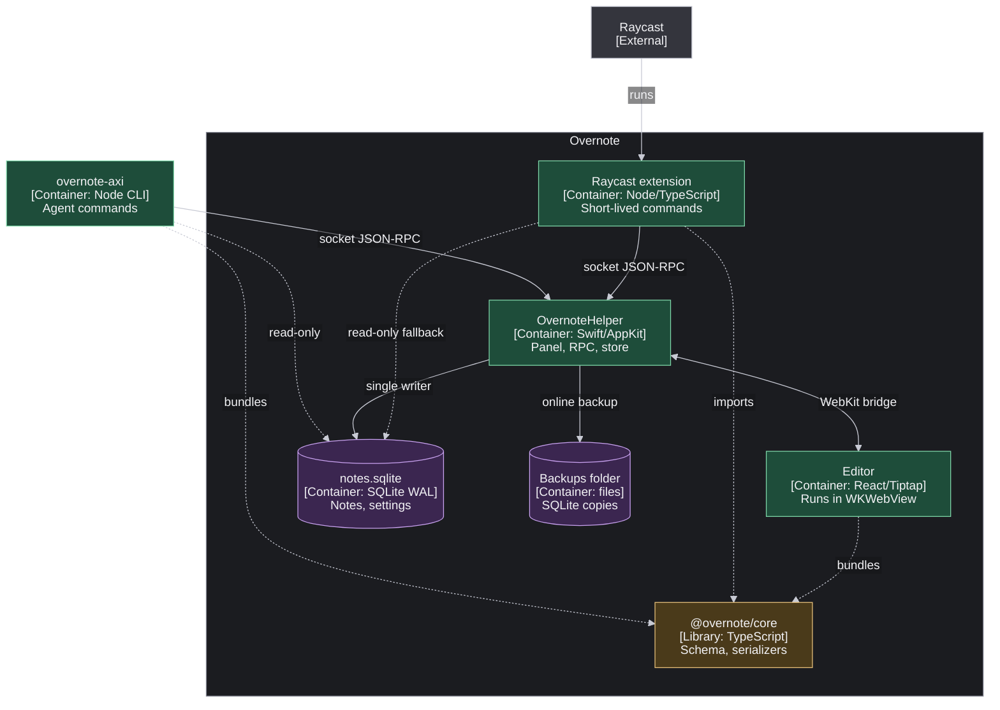
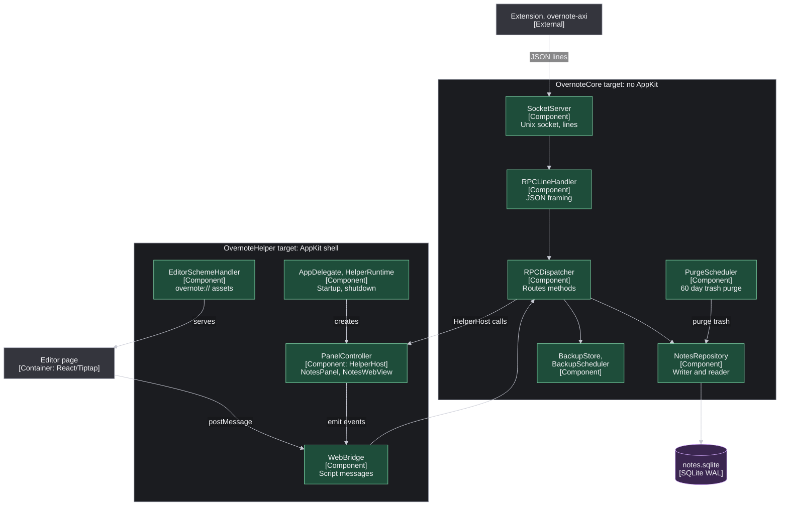
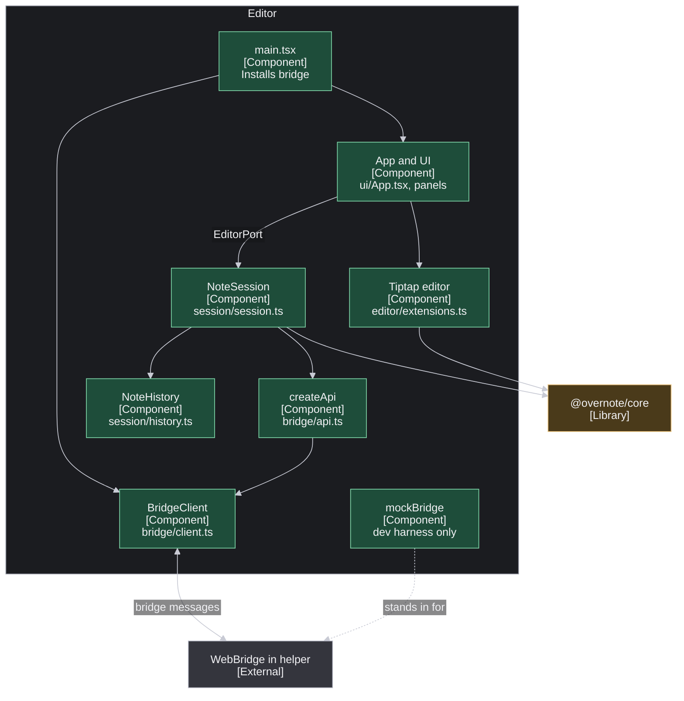
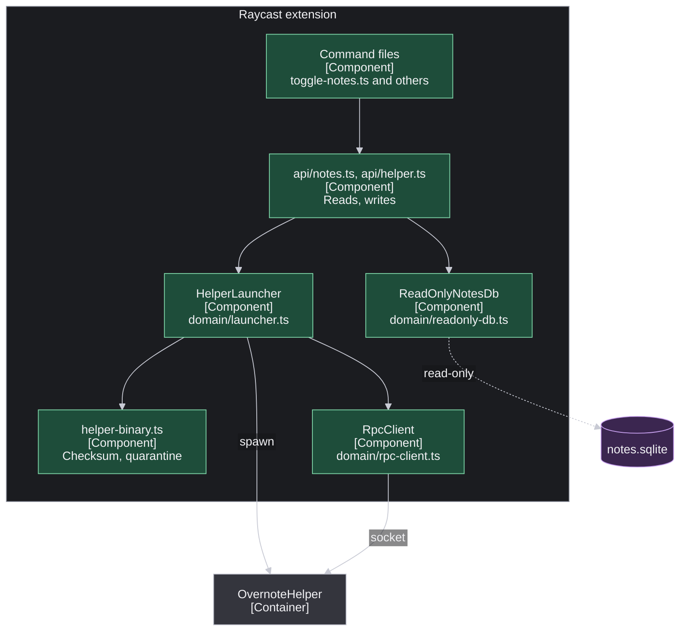
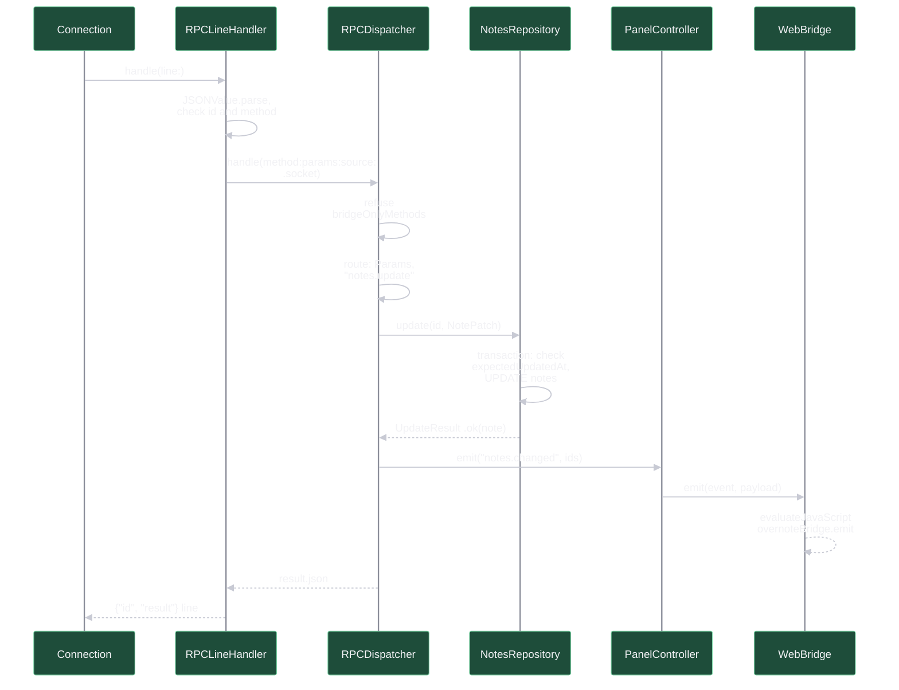
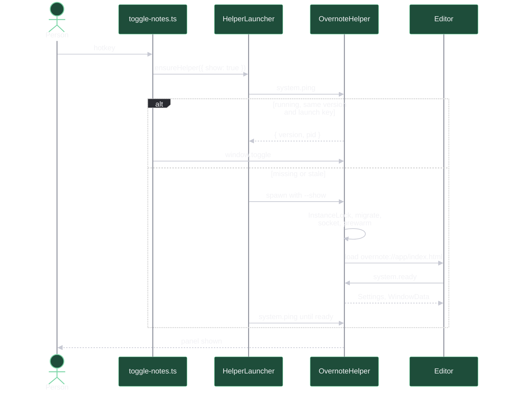
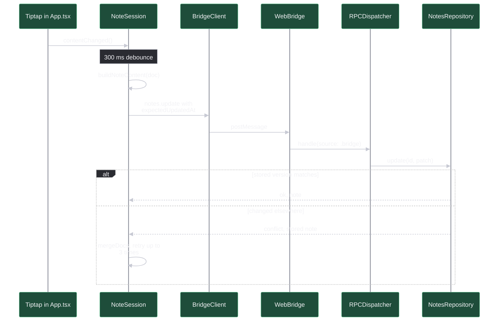
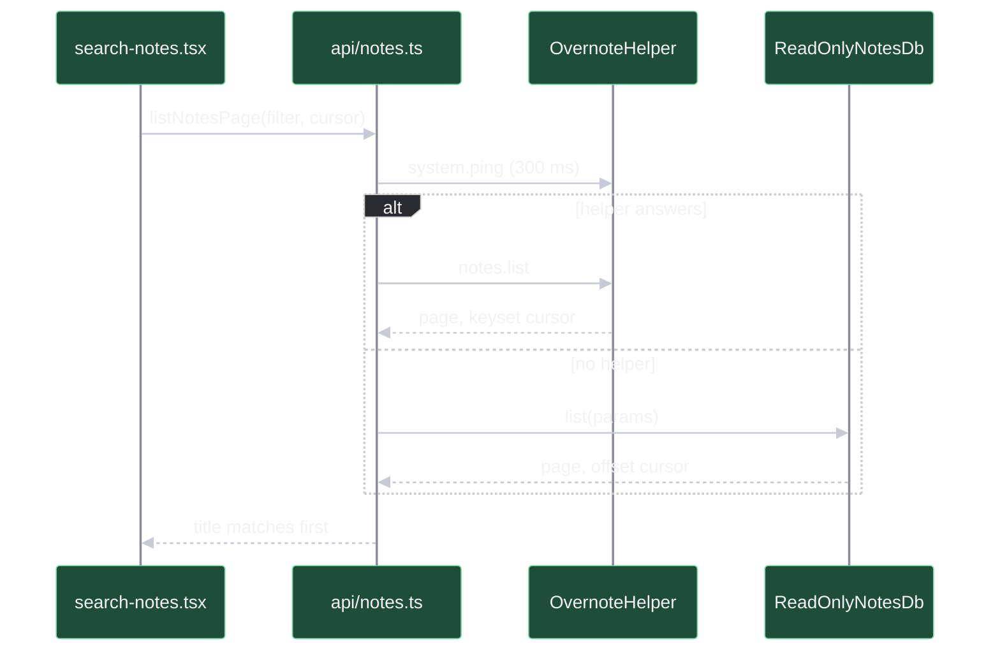
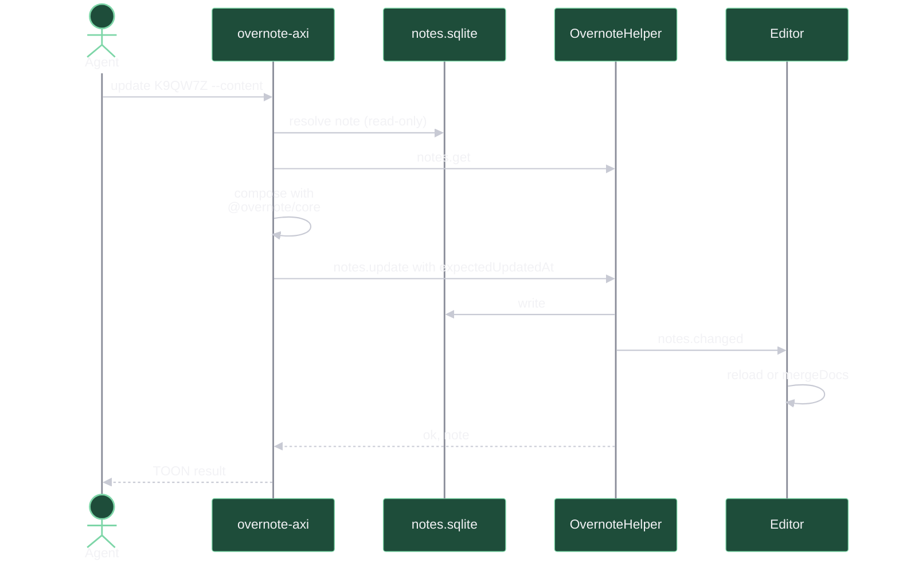

# System design

This is the high level design of Overnote, for the maintainer and for agents that work on it or with it.
It explains why the system is split the way it is, who owns what, where the trust boundaries sit, and how data moves for the main flows.
It ends with a C4 model at all four levels.

The wire protocol (paths, socket JSON-RPC, the WebKit bridge, data types, methods, the database schema, the `@overnote/core` API, and the extension commands) lives in [`../architecture.md`](../architecture.md), and this page links to it instead of repeating it.
The clean-room rules that govern every contribution are in [`../clean-room.md`](../clean-room.md).
The agent CLI described here lives in the sibling repository [WesleyBLDC/overnote-axi](https://github.com/WesleyBLDC/overnote-axi).

## 1. The shape of the system

Overnote is a floating Markdown notepad that a person opens from Raycast with one hotkey.
It ships as a Raycast extension, but the panel, the editor, and the data all live in a separate native process, `OvernoteHelper`.
The same helper binary also ships as `Overnote.app`, a menu bar app with its own hotkey, so Overnote works without Raycast too.

| Part | Where | Runtime | Lifetime |
|---|---|---|---|
| Raycast extension | `src/`, manifest in `package.json` | Node 22 inside Raycast | One short process per command run |
| OvernoteHelper | `helper/Sources/OvernoteHelper` and `helper/Sources/OvernoteCore` | Swift, AppKit, WebKit | Long lived, one per user |
| Editor | `editor/src`, built to `assets/editor/` | React and Tiptap in a `WKWebView` | As long as the helper's panel |
| `@overnote/core` | `packages/core/src` | TypeScript, browser and Node with no DOM | A library, bundled into the editor, the extension, and overnote-axi |
| Overnote.app | `scripts/build-app.sh` wraps the helper binary, editor, and icons into `dist-app/Overnote.app` | Swift, AppKit, WebKit (the helper in app mode) | Long lived, starts at login if enabled |
| Database | `<support dir>/notes.sqlite` | SQLite in WAL mode | Persistent |
| overnote-axi | sibling repo `WesleyBLDC/overnote-axi` | Node 22.16 CLI | One short process per agent call |

### Why a helper process

Raycast runs each extension command as a short-lived Node process, and a command that returns is gone.
A floating panel has to outlive every command: it must stay on screen over full-screen apps and every Space, keep its editor state, and come back instantly on the next hotkey.
Raycast's extension API also has no way to draw an arbitrary always-on-top, non-activating window.

So the work is split.
The helper is a small accessory app (`NSApplication` with the `.accessory` activation policy in `main.swift`) that owns everything long lived: the `NSPanel` subclass `NotesPanel`, the `WKWebView` that hosts the editor, the single writer connection to SQLite, the Unix socket server, backups, and the trash purge.
The extension commands become thin clients: they make sure the right helper is running (`HelperLauncher` in `src/domain/launcher.ts`), send one or two socket requests, and exit.
The panel is prewarmed hidden at startup (`PanelController.prewarm`), so a toggle only orders it in.

### One helper, two hosts

`Overnote.app` and the extension run the same helper and share one data folder, `~/Library/Application Support/Overnote`, so they always edit the same notes.
Only one helper runs at a time, because the socket and the single writer allow one.
App mode (bundle id `com.wesleybldc.overnote` or `--app`) adds a global hotkey (default ⌃⌥N), a menu bar item, and Launch at Login.
`system.ping` reports `host: "app"` or `"extension"`: the extension reuses an app host and never stops it, while the app shuts down an extension helper and takes over.
Every shutdown first flushes the editor's pending edits, so a handover never loses typing.
Details are in "App mode and handover" in [`../architecture.md`](../architecture.md).

### Separation of responsibilities

- **The helper stores, it never interprets content.**
  `NotesRepository` stores `NoteContent` verbatim and never parses Markdown or ProseMirror JSON; it only folds `title` and `text` for search (`TextFolding`).
- **`@overnote/core` is the only code that derives content.**
  The schema, Markdown, HTML and plain text serializers, title rules, the three-way `mergeDocs`, and `duplicateContent` live there, and every writer (editor, extension, overnote-axi) builds `NoteContent` with it, so all of them write notes the same way.
- **One dispatcher serves both doors.**
  `RPCDispatcher` handles requests from the socket and from the WebKit bridge with the same method names and shapes; `RPCSource` tells them apart for the few methods that belong to one side only.
- **The editor owns interaction state.**
  `NoteSession` (`editor/src/session/session.ts`) owns which note is open, autosave, history, and merging outside changes; the helper keeps only what must persist (current note id, settings, panel frame).
- **The panel geometry rules are pure.**
  `PanelGeometry` and `PanelSizing` in `OvernoteCore` compute placements and minimum sizes with no AppKit, so they are unit tested; `PanelController` applies them.
- **`OvernoteCore` has no AppKit.**
  The Swift package splits into `OvernoteCore` (repository, dispatcher, socket, backups, lifecycle) and `OvernoteHelper` (the AppKit and WebKit shell).
  `OvernoteCore` talks to the window only through the `HelperHost` protocol, which `PanelController` implements in the app and `RecordingHost` implements for `--headless` runs and tests.

## 2. Trust boundaries

1. **Socket clients to helper.**
   The socket is `/tmp/overnote-<uid>/helper.sock`.
   `SocketPaths.prepareDirectory` creates the directory with mode 0700 or checks that an existing one is a real directory owned by the user and tightens it to 0700, and `SocketServer.start` sets the socket to 0600.
   Clients check the same thing before they connect: `ensureRuntimeDir` in `src/domain/paths.ts`, and `isTrustedRuntimeDir` plus `isTrustedSocket` in overnote-axi's `src/config/paths.ts`, which refuses a socket another user could have planted.
   Anything that can reach the socket is the same user, so the socket has no authentication beyond file permissions.
2. **Editor page to helper.**
   `WebBridge` accepts script messages only from the main frame of the `overnote://` scheme, which `EditorSchemeHandler` serves from `--editor-dir`.
   Socket-only methods (`system.status`, backups, restore) are refused on the bridge, and bridge-only methods (`system.ready`, window sizing, clipboard, save panel, `app.openURL`) are refused on the socket.
   The production editor HTML carries a strict Content Security Policy with `connect-src 'none'` (`editor/vite.config.ts`), navigation away from `overnote://` is cancelled, and links open in the default browser through `NSWorkspace` after `LinkPolicy` checks the scheme.
3. **Release download to installed binary.**
   The helper is ad-hoc signed, not notarized.
   `prepareBinary` in `src/domain/helper-binary.ts` checks the binary against `assets/bin/OvernoteHelper.sha256` and only then removes the quarantine attribute, so a binary that does not match is never started.
   `scripts/update-extension.sh` accepts only HTTPS and checks the zip against the release's `SHA256SUMS`.
4. **Agents to notes.**
   overnote-axi reads the database read-only and writes only through the helper, so an agent has exactly the powers of a socket client, and destructive operations need explicit flags (`--permanent`).
5. **Network.**
   The only network call in the product is Check for Updates (`src/check-for-updates.ts`, GitHub releases API); the helper and editor make none.

## 3. Data flows

### Opening the panel from Raycast

1. The person presses the hotkey bound to Toggle Overnote, and Raycast runs `src/toggle-notes.ts`.
2. `ensureHelper({ show: true })` (`src/api/helper.ts`) asks `HelperLauncher.ensure`, which prepares the runtime directory, reads the bundled helper version, and pings the socket.
3. A helper that answers with the bundled version and matches the launch record (pid plus a key built from the binary checksum and launch arguments) is reused, and the command sends `window.toggle`.
4. Otherwise the launcher takes a mkdir lock, stops a stale helper (`system.shutdown`, then SIGTERM), spawns `OvernoteHelper` with `--show`, waits for `system.ping`, and records the launch.
5. On a cold start the helper takes its `InstanceLock` on the pid file, opens and migrates the database, starts the socket server, prewarms the panel, and shows it.
   A second helper started with `--show` finds the lock taken, forwards `window.show` to the running one through `RPCClient`, and exits.
6. The editor boots inside the web view, calls `system.ready`, and gets `Settings` and `WindowData` for the persisted current note.

### Typing and saving a note

1. Tiptap reports a document change and `App.tsx` calls `NoteSession.contentChanged`.
2. After a 300 ms debounce (or on switch, hide, or blur) `saveContent` builds `NoteContent` with core's `buildNoteContent` and calls `notes.update` with `expectedUpdatedAt` set to the version it last synced.
3. `BridgeClient` posts the request to `window.webkit.messageHandlers.overnote`; `WebBridge` queues it behind the previous message so saves land in order, and hands it to `RPCDispatcher` with source `.bridge`.
4. `NotesRepository.update` writes the content and folded copies in one transaction on the single writer connection, or returns `conflict` with the stored note when `expectedUpdatedAt` is stale.
5. On `conflict` the session merges the stored note into its edits with `mergeDocs` and retries, up to 3 attempts.
6. A write that came through the socket instead makes the dispatcher emit `notes.changed`, and the session reloads or merges that note in place.

### Searching from Raycast

1. Search Notes (`src/search-notes.tsx`) runs `useSearch`, which pages through `listNotesPage` in `src/api/notes.ts`.
2. `read()` pings the helper with a 300 ms budget; a running helper answers `notes.list` from its read-only second connection, with keyset cursors.
3. When no helper answers, `ReadOnlyNotesDb` opens `notes.sqlite` with `node:sqlite` in read-only mode and runs the same order and folded matching, with offset cursors, so the list is instant without starting the helper.
4. The command moves title matches first within each page, renders the Markdown detail, and sends every write (pin, duplicate, delete, backup, restore) through the helper.

### An agent using overnote-axi

1. An agent runs a command such as `overnote-axi update K9QW7Z --content "- [ ] call Sam"`.
2. Reads (`home`, `list`, `search`, `read`, `links`, and reference resolution) open the same database read-only with `node:sqlite`, `PRAGMA query_only`, and one snapshot per command, so they work while Overnote is closed.
3. Writes go through `NotesWriter` (`src/helper/notes-writer.ts`) over the helper socket, after the trust check.
   Content writes first fetch the note with `notes.get`, compose the change on the stored document with the bundled `@overnote/core` (`src/markdown/convert.ts`), and send `notes.update` with `expectedUpdatedAt`.
4. The helper emits `notes.changed`, so an open editor reloads or merges the change into unsaved typing.
5. When the helper is not running, writes fail with `HELPER_NOT_RUNNING`, and `overnote-axi open` starts Overnote through its Raycast deeplink (`raycast://extensions/wesleybldc/overnote/open-notes`), which runs the extension, which launches the helper.

## 4. Persistence

- **One file, one writer.**
  `NotesRepository` opens `notes.sqlite` with `journal_mode = WAL` and `synchronous = NORMAL`, serializes every write under one lock on one connection, and keeps a second read-only connection for list, browse, deleted list, and count, so a long read never delays a save.
  The extension's fallback and overnote-axi are further read-only readers; WAL lets them read the last committed state without blocking the writer.
- **Migrations.**
  `Migrations` tracks `PRAGMA user_version`, applies each step in one transaction, and refuses a database newer than the helper.
  Schema 2 added generated sort columns, paging indexes, and an FTS5 trigram index, and applies without the index where FTS5 is missing.
- **Backups.**
  `BackupStore` writes consistent copies with SQLite's online backup API into `~/Library/Application Support/Overnote/backups` (outside the extension, so they survive an uninstall), and `BackupScheduler` writes a daily one.
  The other reasons are manual, pre-migration, pre-update, and pre-restore, and retention keeps the newest 10 plus one per week for 4 weeks.
- **Restore offer.**
  When the helper starts with no database but finds backups, it starts empty and sets a restore offer that Search Notes and the menu bar show.
- **Trash.**
  `PurgeScheduler` removes notes deleted more than 60 days ago, at startup and every 24 hours.

Details are in sections 6 and 9 of [`../architecture.md`](../architecture.md).

## 5. Protocol versioning

The protocol has a document version (v3.4 at the time of writing) at the top of [`../architecture.md`](../architecture.md), bumped in the same pull request as any change to a method, event, type, the schema, or the core API.
The version is not sent on the wire.
Instead the helper reports its release version (`helper/VERSION`, compiled into `HelperVersion.current`) through `system.ping`, and the launcher restarts any helper whose version or binary checksum differs from the bundled one, so the extension, helper, and editor of one release always speak the same protocol.
External clients such as overnote-axi read `system.ping` or `system.status` to learn which behavior they can expect, and overnote-axi checks database columns rather than an exact schema version.

## 6. Install and update

- A release zip carries the prebuilt arm64 helper with its checksum, the built editor, and `assets/prebuilt.json`.
- `npm run install-extension` (`scripts/install-extension.sh`) checks Node and Raycast, installs dependencies, prepares assets (`scripts/prepare-assets.sh`), and runs `ray develop` once to register the extension.
- `npm run update-extension` (`scripts/update-extension.sh`) downloads and checks the new zip, refuses a rollback to an older schema, backs up with reason `pre-update`, stops the helper, replaces files with `rsync`, and reinstalls.
  The next Raycast command starts the new helper.
- Check for Updates only copies the update command to the clipboard; it never runs it.
- `npm run app:install` builds `Overnote.app`, ad hoc signed for this Mac, and copies it to `/Applications`; notarized distribution comes later.

The steps are in [`../install.md`](../install.md) and section 9 of [`../architecture.md`](../architecture.md).

## 7. Testing layers

- **Core:** the serialization fixture runner over `packages/core/tests/fixtures/` and a shared fold corpus that the Swift side also checks.
- **Units:** helper unit tests (`helper/test.sh`), extension unit tests for launcher and cursor logic, and editor unit tests.
- **Editor end to end:** Playwright with WebKit against the browser harness and its mock bridge (`editor/src/dev/mockBridge.ts`), plus `editor/tests/real-helper.spec.ts`, which runs the shipped editor build against a real headless helper through the `test.asBridge` hook.
- **Helper and commands end to end:** `scripts/smoke-helper.sh` over the real socket, and `src/__tests__/commands.e2e.test.ts` for the Raycast commands' data layer.
- **Install and update:** `scripts/e2e-update.sh`, headless, against temporary folders.
- **Window:** `scripts/e2e-window.sh` shows the real panel and is run by hand only.
- **overnote-axi:** its own unit, integration (against a real headless helper when one is built in the sibling checkout), and built binary tests.

`npm run verify` runs the full local gate; see the Testing policy in `CONTRIBUTING.md`.

## 8. C4 model

The diagrams use C4 notation on Mermaid flowcharts.
Blue boxes are people, green boxes are Overnote's own containers and components, amber is a library, violet is a data store, and gray is external.

### Level 1: System context

The person works in Overnote's panel and reaches it through Raycast, which runs the extension that starts and drives the helper.
Agents reach the same notes through overnote-axi, which reads the database and writes through the helper, and which uses a Raycast deeplink to start Overnote when it is closed.
Overnote's only outbound call is the update check against GitHub releases.

### Level 2: Containers

The helper is the hub: it is the only writer of `notes.sqlite`, it hosts the editor, and it serves the socket that both the extension and overnote-axi use.
Dashed lines are reads or build-time bundling: the extension and overnote-axi may read the database directly, and three containers bundle `@overnote/core`.
overnote-axi sits outside the Overnote boundary because it is a separate repository and release, though it speaks the same protocol.

### Level 3: Components of OvernoteHelper

Two doors lead into one `RPCDispatcher`: `SocketServer` and `RPCLineHandler` for socket clients, and `WebBridge` for the editor page.
The dispatcher reaches the window only through the `HelperHost` protocol, implemented by `PanelController`, which owns `NotesPanel` and `NotesWebView` and sends events back to the page through `WebBridge`.
`AppDelegate` creates `PanelController`, and `HelperRuntime` takes the `InstanceLock` on the pid file, opens `NotesRepository`, starts `SocketServer`, `BackupScheduler`, and `PurgeScheduler`, and shuts everything down on `system.shutdown` or a signal.
`EditorBuildWatcher` (development only, `--watch-editor`) and `TestHooks` (`--test-hooks`) sit beside `PanelController` and are left out of the diagram.

### Level 3: Components of the editor

`main.tsx` installs `window.overnoteBridge` (a `BridgeClient`) before anything is sent, and in the dev server installs `mockBridge` when no native handler exists.
`App.tsx` creates the Tiptap editor and hands `NoteSession` an `EditorPort`, so the session has no React or DOM dependency and is unit tested.
`NoteSession` talks to the helper only through the typed `createApi` wrapper, and uses core for `buildNoteContent`, `loadDoc`, and `mergeDocs`.

### Level 3: Components of the Raycast extension

Command files stay thin and call `src/api/`.
`HelperLauncher` decides whether to reuse, restart, or spawn the helper, using `helper-binary.ts` to verify the binary and `RpcClient` to ping it.
Reads try the helper first and fall back to `ReadOnlyNotesDb` so lists never wait for a cold start.

### Level 4: Code, one request from the socket to the store

A `Connection` inside `SocketServer` splits incoming bytes into lines and passes each to `RPCLineHandler.handle(line:)`, which parses JSON and maps any failure to a JSON-RPC error.
`RPCDispatcher.handle` refuses methods that belong to the other door, then `route` reads typed values through `Params` and calls `NotesRepository.update`, which checks `expectedUpdatedAt` and writes inside one transaction under the writer lock.
Because the source is the socket, the dispatcher announces the change with `notes.changed` through the `HelperHost` (here `PanelController`), which forwards it to the page with `WebBridge.emit`.
A bridge request takes the same path from `WebBridge.userContentController` into `RPCDispatcher.handle` with source `.bridge`, and skips the `notes.changed` step, since the editor made the change itself.

## 9. Flow diagrams

### Opening the panel

The fast path is one ping and one `window.toggle`, because the panel already exists hidden.
The slow path happens on first use, after an update, or after a crash, and the launch lock keeps two commands from spawning two helpers.

### Typing and saving

The editor never overwrites an outside change: a stale save comes back as `conflict` and is merged block by block before it is retried.

### Searching from Raycast

Search never starts the helper just to list notes; writes from the list (pin, duplicate, delete) do go through the helper.

### An agent writing through overnote-axi

The CLI resolves the note from SQLite, fetches it fresh through the helper, edits the stored document rather than rebuilding it from Markdown, and lets the helper do the write.
For the note open in the panel it also waits past the autosave debounce and checks that its blocks survived, reporting `OVERWRITTEN_BY_EDITOR` if not.

## 10. Where to read next

- [`../architecture.md`](../architecture.md): the protocol reference.
- [`../install.md`](../install.md): install, update, backup, and uninstall.
- [`../clean-room.md`](../clean-room.md): what contributors may and may not read.
- `CONTRIBUTING.md` at the repository root: layout, testing policy, and conventions.
- [WesleyBLDC/overnote-axi](https://github.com/WesleyBLDC/overnote-axi) `docs/DESIGN.md`: the agent CLI's own design.
